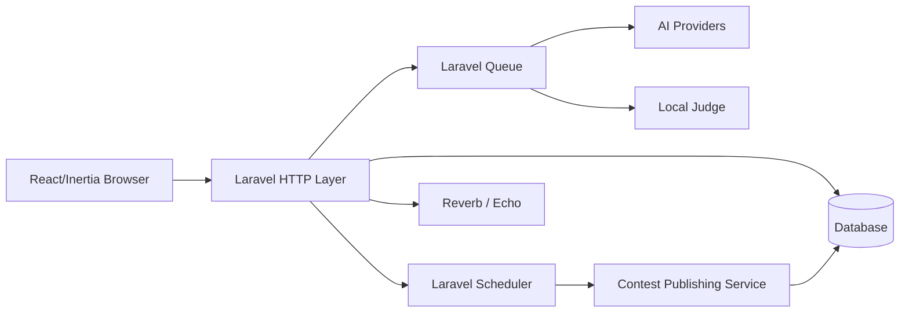
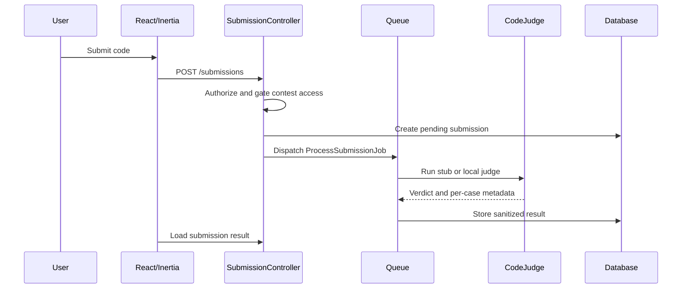
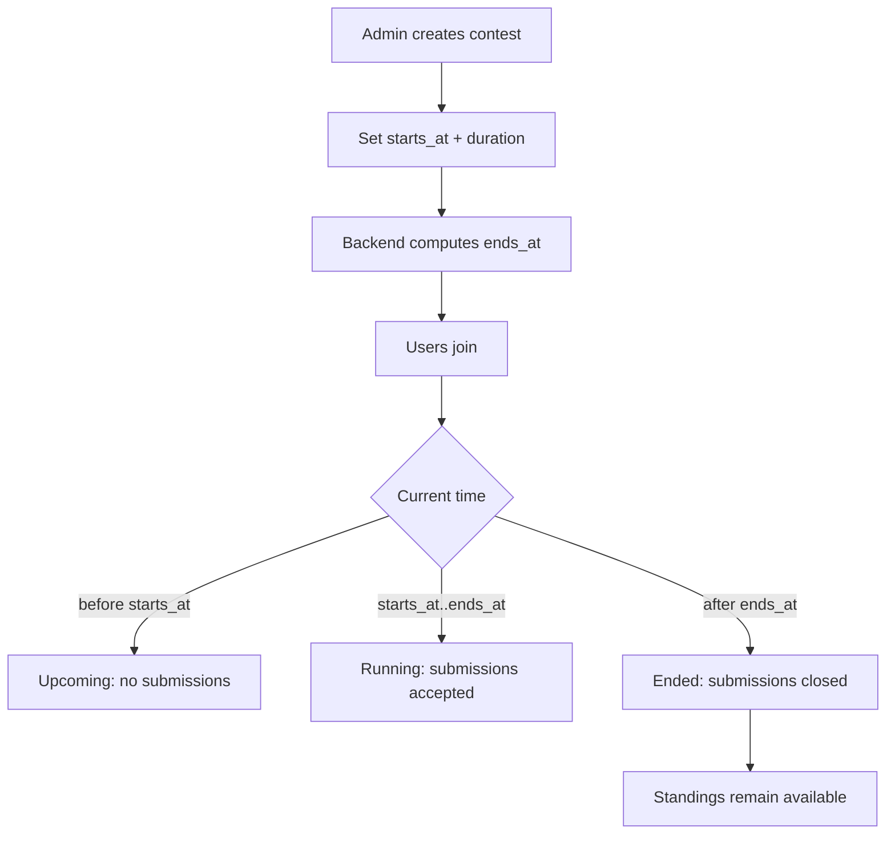
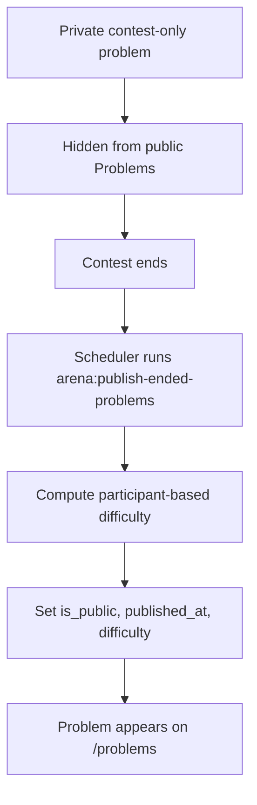
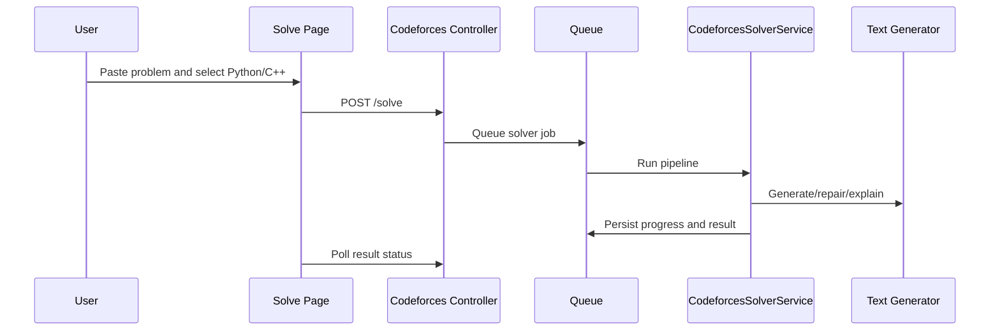
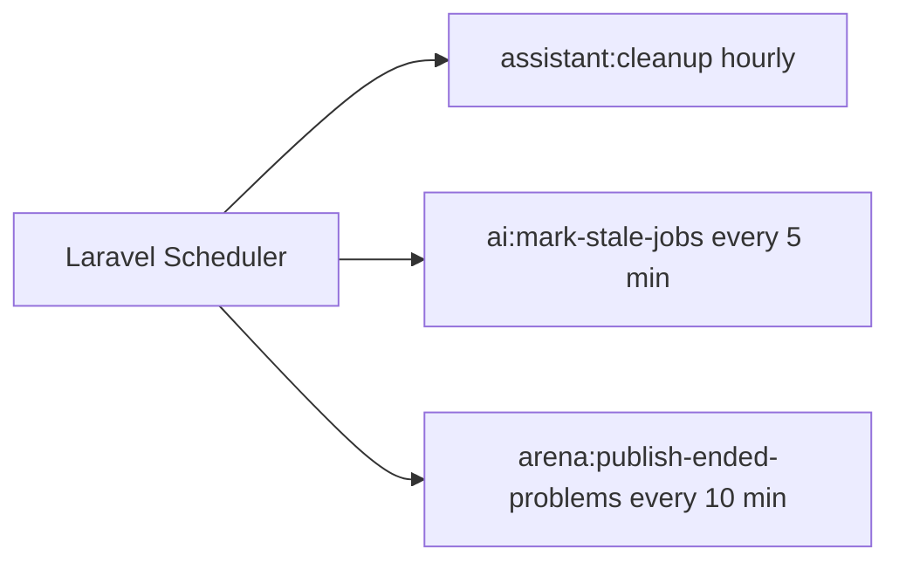

# ALGOAG Architecture

## High-Level Architecture

ALGOAG is a Laravel monolith with an Inertia-powered React frontend. Laravel owns routing, authentication, authorization, validation, persistence, queues, scheduling, broadcasting, and the local judge boundary. React owns the interactive user and admin screens.



## Backend Structure

- `routes/web.php`: public, auth, problems, submissions, Arena, assistant, Codeforces, and admin routes.
- `routes/console.php`: scheduled cleanup, stale AI job marking, and Arena publishing.
- `routes/channels.php`: private broadcast authorization channels.
- `app/Http`: shared controllers, requests, middleware, and auth.
- `app/Modules`: domain modules for Admin, Arena, Execution, Problems, Patterns, Realtime, and Assistant actions.
- `app/Services`: AI, assistant, content, Codeforces, benchmark, and provider services.
- `app/Jobs`: queued processing for submissions, assistant analysis, and Codeforces solving.
- `app/Policies`: user-level access rules for submissions, assistant sessions, Codeforces solutions, and problems.

## Frontend Structure

- `resources/js/app.jsx`: Inertia bootstrapping and global providers.
- `resources/js/bootstrap.js`: Axios/Echo setup and runtime configuration.
- `resources/js/Pages`: route-level pages for Landing, Problems, Arena, Admin, Assistant, Codeforces, Courses, and Submissions.
- `resources/js/components/ui`: local Shadcn-style primitives such as Button, Card, Badge, Table, Input, Textarea, and Alert.
- `resources/js/lib`: frontend helpers for locale, assistant workspace state, verdicts, and E2E visual support.

## Module Overview

### Problems

Problems live in `App\Modules\Problems\Models\Problem`. Public visibility requires `is_public=true`, `published_at` not null, and `published_at <= now()`. Tags/topics use the `Tag` model through the `problem_tag` pivot.

### Submissions

`SubmissionController` creates submissions after authorization and contest gate checks. `ProcessSubmissionJob` runs the configured `CodeJudge` and stores sanitized verdict data. Hidden test input and expected output are not exposed to the browser.

### Arena / Contests

`Contest` supports timed contests and practice contests. Timed contests use `starts_at` and computed `ends_at`; admin users enter start time plus duration. Gatekeeping is centralized through methods such as `acceptsSubmissions()`, `hasStarted()`, and `hasEnded()`.

### Publishing

`PublishEndedContestProblemsService` scans ended, non-practice contests with unpublished contest-only problems. It computes difficulty, publishes problems, and marks `problems_published_at`. The command is `arena:publish-ended-problems`.

### Standings

`StandingService` computes ICPC-style rankings: solved count descending, penalty ascending, and a 20-minute penalty for wrong attempts before first accepted submission.

### AI Assistant

Assistant routes and services support session-based analysis, provider resolution, STT/TTS, and broadcast/polling status updates.

### Codeforces Solver

`CodeforcesSolveController`, `QueueCodeforcesSolutionAction`, and `CodeforcesSolverService` coordinate Python/C++ solution generation, repair, explanation, and result status.

### Admin

Admin routes are protected by auth and admin middleware. Admin pages manage users, topics, courses/lessons, problems/tags/test cases, contests, and settings.

### Courses / Topics

Courses have ordered lessons. Topics are the `tags` table, shared between Admin, Landing, Problems filters, and problem cards.

## Data Flows

### User Submits Solution



### Contest Lifecycle



### Contest-Only Problem Publishing



### AI Solver Flow



## Queue Flow

The queue processes:

- `ProcessSubmissionJob` for local/stub judging.
- `ProcessCodeforcesSolutionJob` for AI Codeforces solving.
- `ProcessAnalysisJob` for assistant workflows.

Use `QUEUE_CONNECTION=database` and run:

```bash
php artisan queue:work
```

## Scheduler Flow



## Security Boundaries

- Admin routes require authenticated admin users.
- Users can only view their own submissions.
- Hidden tests are never sent to the browser.
- Contest-only problems are hidden from public routes until published.
- Private broadcast channels verify user IDs.
- Real local judge execution is disabled by default and must not be used in production without sandboxing.
