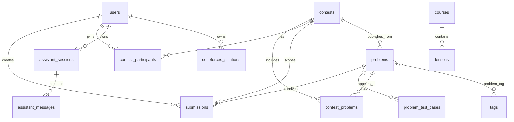

# ALGOAG Database Notes

## Main Entities

- `users`: application accounts, including `is_admin`.
- `problems`: public and contest-only problem statements and metadata.
- `tags`: topics shared by Admin, Landing, Problems filters, and problem pages.
- `problem_tag`: many-to-many pivot between problems and tags.
- `problem_test_cases`: sample and hidden judge test cases.
- `submissions`: user submissions, verdicts, judge metadata, and optional contest association.
- `contests`: timed/practice contests.
- `contest_problems`: contest-problem pivot with labels and ordering.
- `contest_participants`: contest registration pivot.
- `courses`: learning paths.
- `lessons`: ordered course lessons.
- `assistant_sessions`, `assistant_messages`: assistant conversation state.
- `codeforces_solutions`: Codeforces solver jobs/results.
- `jobs`: database queue.
- `ai_usage_records`: AI usage accounting.

## Relationships

## Visibility Model

Public Problems require all of the following:

- `is_public = true`
- `published_at is not null`
- `published_at <= now()`

Contest-only private problems use:

- `is_public = false`
- `published_at = null`
- `published_from_contest_id = contests.id`

The public Problems index and show route use this visibility model so unpublished contest-only problems are not exposed publicly.

## Publishing Fields

On problems:

- `is_public`: whether the problem is visible publicly.
- `published_at`: when it became public.
- `published_from_contest_id`: source contest for contest-only problems.

On contests:

- `problems_published_at`: marks that private contest-only problems have already been processed.

## Contest Tables

`contests` stores:

- `starts_at`
- `ends_at`
- `is_public`
- `is_practice`
- `problems_published_at`
- `created_by`

`contest_problems` stores:

- `contest_id`
- `problem_id`
- `label`
- `ordinal`
- unique `(contest_id, problem_id)`

`contest_participants` stores:

- `contest_id`
- `user_id`
- `registered_at`
- unique `(contest_id, user_id)`

## Courses And Lessons

`courses` store path-level content. `lessons` belong to a course and include ordered management fields:

- `title`
- `description`
- `content`
- `video_url`
- `position`
- `is_published`

Public course pages display published lessons in order.
