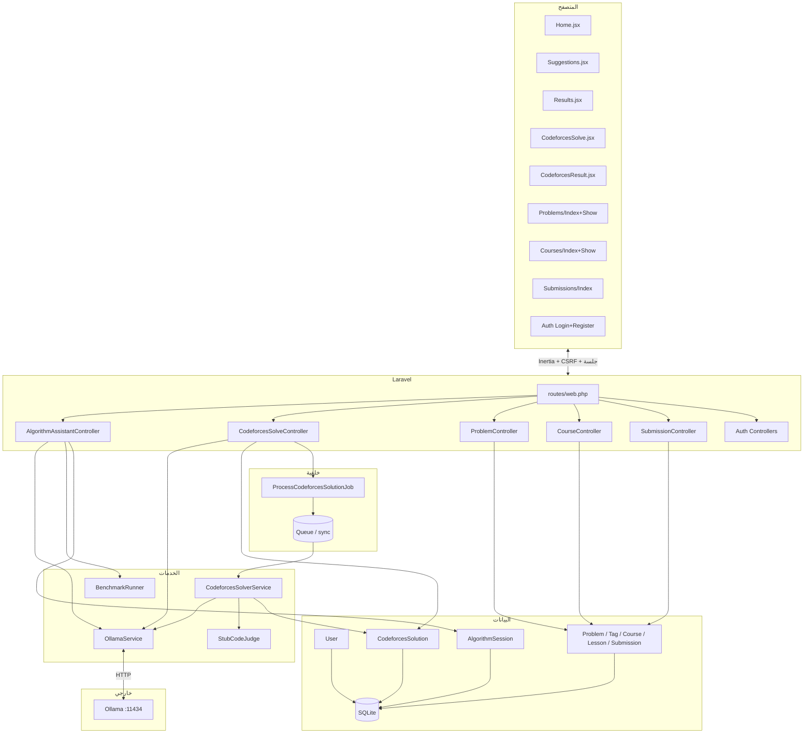
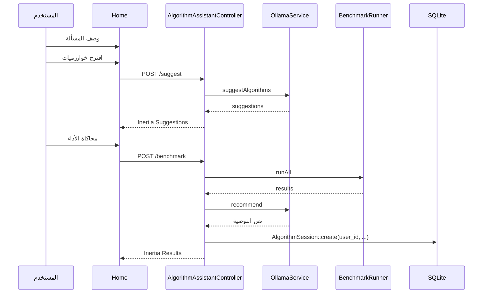
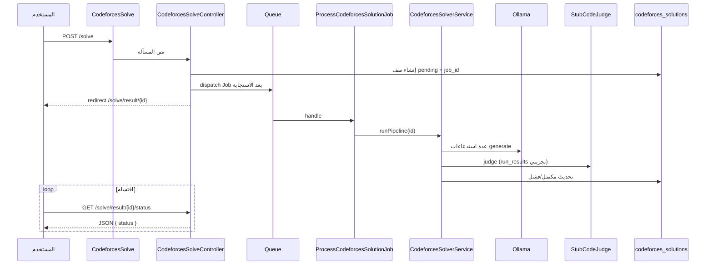
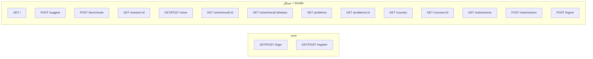

# رسوم المعمارية — مساعد تصميم الخوارزميات (AlgoAG)

## ١. معمارية النظام العامة

## ٢. تدفق مساعد الخوارزميات (اقتراح + محاكاة)

## ٣. تدفق حل Codeforces (طابور + اقتسام)

## ٤. خريطة المسارات (أساسية)

---

*مكمّل لتقرير التدقيق `FULL-PROJECT-AUDIT-AR.md` و`README.md`.*
